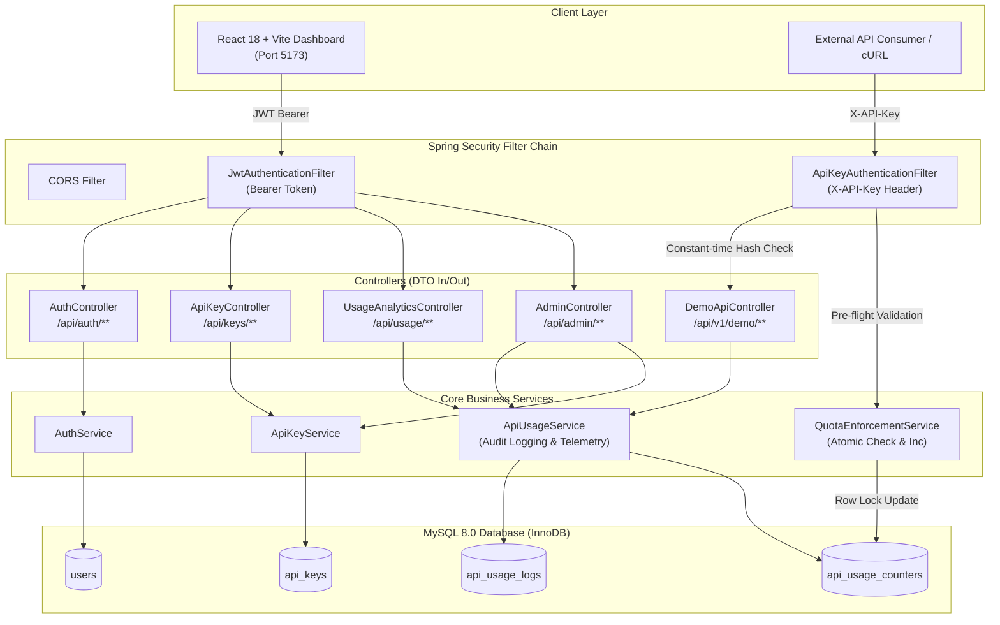
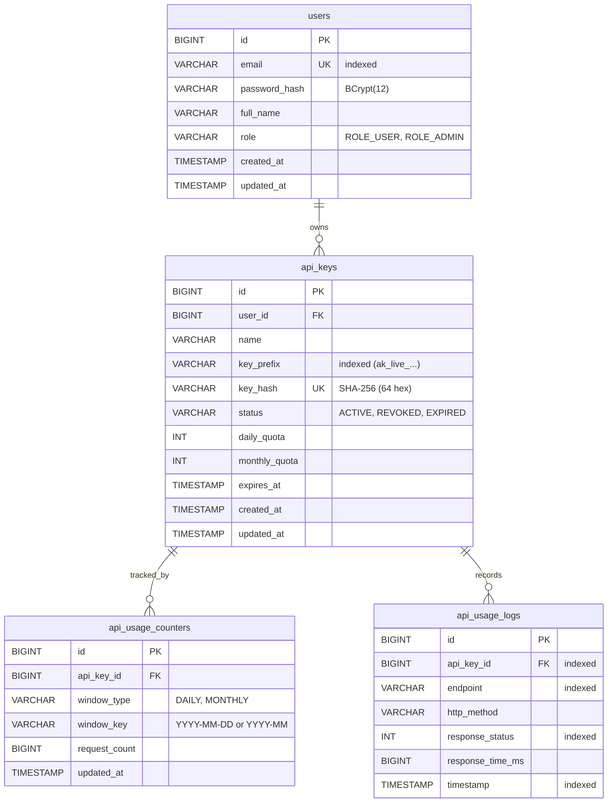

<div align="center">

# 🛡️ KeyShield — API Key & Usage Management Platform

**Enterprise-grade API credential lifecycle, atomic MySQL quota enforcement, and real-time usage telemetry.**

[](https://openjdk.org/)
[](https://spring.io/projects/spring-boot)
[](https://www.mysql.com/)
[](https://react.dev/)
[](https://vitejs.dev/)
[](http://localhost:8080/swagger-ui.html)
[](LICENSE)

<br/>

**Built by [Aditya Asthana](https://github.com/adityaasthana)**  
*Targeted for Software Engineer, Java Developer, and Backend Engineering Roles*

<br/>

[Key Highlights](#-key-highlights) •
[Architecture](#-system-architecture) •
[Concurrency & Quotas](#-concurrency-safe-rate--quota-engine) •
[Security Model](#-zero-knowledge-security-model) •
[Interactive Console](#-interactive-developer-console) •
[API Reference](#-api-endpoints) •
[Local Setup](#-local-setup--quickstart) •
[Automated Tests](#-test-coverage--verification) •
[Author](#-author)

</div>

---

## 🌟 Key Highlights

- **🔒 Zero-Knowledge Key Storage**: Keys are generated using `java.security.SecureRandom` (32 bytes entropy) formatted as `ak_live_<prefix>_<secret>`. The database stores **only** SHA-256 hashes—raw secrets are shown **strictly once** upon generation.
- **⚡ Constant-Time Verification**: Hash verification employs `MessageDigest.isEqual` to mathematically eliminate side-channel timing attacks.
- **🛡️ Concurrency-Safe Quota Engine**: Implements atomic database row-level locking via conditional SQL updates (`UPDATE ... WHERE request_count < quota`), eliminating race conditions without requiring Redis or Bucket4j.
- **📊 Real-Time MySQL Telemetry**: Fast analytical aggregations (`DATE_FORMAT`, `COUNT`, `AVG`) with composite indexing to track daily request volume, endpoint breakdown, latency percentiles, and full audit logs.
- **👥 Role-Based Access Control (RBAC)**: Distinguishes between `ROLE_USER` and `ROLE_ADMIN` with stateless HMAC-SHA256 JWT tokens. Automated admin bootstrapping promotes the first registered account.
- **🧪 Live API Sandbox**: Built-in developer console in React for executing requests against protected endpoints (`GET /profile`, `GET /data`, `POST /echo`) with live latency and HTTP 200/401/403/429 feedback.
- **🎨 Sleek Dark UI**: Engineered with custom Vanilla CSS (no CSS bloat or Tailwind), accessible contrast, responsive grid layouts, and smooth SVG visualizations.

---

## 🏗️ System Architecture

KeyShield is built as a **Modular Monolith** with clean separation of concerns:

```
Controller Layer  ──>  Service Layer  ──>  Repository Layer  ──>  MySQL 8 (InnoDB)
  (REST & DTOs)       (Business Logic)    (Spring Data JPA)        (ACID Storage)
```



---

## 🗄️ Database Entity Relationship (ERD)



---

## ⚡ Concurrency-Safe Rate & Quota Engine

> [!IMPORTANT]
> **Why Unprotected Count Checks Fail:**  
> A naive check (`SELECT COUNT(*) FROM logs ...` followed by an increment) causes race conditions under simultaneous requests. If 50 parallel requests hit an endpoint with 99/100 quota used, all 50 can read 99 and succeed, allowing 149 requests.

### The MySQL Atomic Solution
KeyShield bypasses this using **dedicated window counter rows** with **atomic conditional SQL updates** that leverage InnoDB's row-level locking:

```sql
UPDATE api_usage_counters
SET request_count = request_count + 1, updated_at = :now
WHERE api_key_id = :keyId
  AND window_type = :windowType
  AND window_key = :windowKey
  AND (:quota IS NULL OR request_count < :quota);
```

1. **InnoDB Row Lock**: When a request executes this query, InnoDB places an exclusive index row lock on `(api_key_id, window_type, window_key)`.
2. **Conditional Increment**: If `request_count < quota`, the counter increments and the query returns `updatedRows = 1`.
3. **Strict Rejection**: If `request_count >= quota`, the condition fails and returns `updatedRows = 0`.
4. **Immediate 429**: When 0 rows update, `QuotaEnforcementService` throws `QuotaExceededException`, immediately returning **HTTP 429 Too Many Requests**.

---

## 🔐 Zero-Knowledge Security Model

```
   Raw Secret (User View Once)             Stored in MySQL
   ───────────────────────────             ───────────────
   ak_live_a1b2c3d4_f89e2c...   ───►   Hash: 8f9a2e3... (SHA-256)
                                       Prefix: ak_live_a1b2c3d4
```

1. **Cryptographic Generation**: `ApiKeyGenerator.generate()` produces 32 cryptographically secure bytes using `SecureRandom`.
2. **One-Way SHA-256 Hashing**: Only the non-secret prefix and the 64-character SHA-256 hex hash are written to MySQL.
3. **Constant-Time Comparison**: 
   ```java
   MessageDigest.isEqual(incomingHash.getBytes(), storedHash.getBytes());
   ```
4. **Tenant Isolation**: Every database query filters by `principal.getId()`. Attempts to query or revoke another user's key trigger `HTTP 403 Forbidden`.

---

## 💻 Interactive Developer Console

The frontend provides an integrated **API Live Tester** (`/tester`):
- **Live Endpoint Execution**: Test `GET /profile`, `GET /data`, and `POST /echo` in real time.
- **Instant Feedback**: Inspect HTTP status badges, round-trip server latency (ms), and JSON response bodies.
- **Quota & Revocation Verification**: Verify that exceeding your daily quota immediately yields HTTP 429, and revoking a key immediately returns HTTP 403.
- **Telemetry Reflection**: All requests instantly appear in the **Request History** (`/logs`) and **Usage Analytics** (`/usage`) graphs.

---

## 📡 API Endpoints

### Authentication (`/api/auth`)
| Method | Endpoint | Access | Description |
|---|---|---|---|
| `POST` | `/api/auth/register` | Public | Register new account (1st user becomes `ROLE_ADMIN`) |
| `POST` | `/api/auth/login` | Public | Authenticate credentials and receive Bearer JWT |
| `GET` | `/api/auth/me` | Bearer JWT | Fetch current user session profile |

### API Key Management (`/api/keys`)
| Method | Endpoint | Access | Description |
|---|---|---|---|
| `POST` | `/api/keys` | Bearer JWT | Generate key (returns raw key once + metadata) |
| `GET` | `/api/keys` | Bearer JWT | List current user's keys (safe metadata only) |
| `GET` | `/api/keys/{id}` | Bearer JWT | Get specific key details (ownership validated) |
| `PATCH` | `/api/keys/{id}` | Bearer JWT | Update key name, status, or quota limits |
| `DELETE` | `/api/keys/{id}` | Bearer JWT | Revoke an API key immediately |

### Protected Demo APIs (`/api/v1/demo`)
| Method | Endpoint | Access | Description |
|---|---|---|---|
| `GET` | `/api/v1/demo/profile` | `X-API-Key` | Verify key validity and return client metadata |
| `GET` | `/api/v1/demo/data` | `X-API-Key` | Fetch protected dataset |
| `POST` | `/api/v1/demo/echo` | `X-API-Key` | Echo JSON payload with key prefix and timestamp |

### Usage Analytics (`/api/usage`)
| Method | Endpoint | Access | Description |
|---|---|---|---|
| `GET` | `/api/usage/summary` | Bearer JWT | High-level summary (today, total, success, fail, latency) |
| `GET` | `/api/usage/by-day` | Bearer JWT | Daily traffic volume trend (last N days) |
| `GET` | `/api/usage/by-endpoint` | Bearer JWT | Request distribution grouped by endpoint |
| `GET` | `/api/usage/history` | Bearer JWT | Paginated request logs with status and latency |

### Admin Oversight (`/api/admin`) — *Requires ROLE_ADMIN*
| Method | Endpoint | Access | Description |
|---|---|---|---|
| `GET` | `/api/admin/users` | Admin JWT | Paginated list of all platform users |
| `GET` | `/api/admin/keys` | Admin JWT | Paginated list of all keys across all tenants |
| `GET` | `/api/admin/usage/summary` | Admin JWT | Global system-wide usage metrics |
| `GET` | `/api/admin/usage/history` | Admin JWT | Global paginated request audit trail |

---

## 🚀 Local Setup & Quickstart

### Prerequisites
- **Java 21 LTS** (`java -version`)
- **Maven 3.8+** (`mvn -v`)
- **Node.js 18+** & npm (`node -v`, `npm -v`)
- **MySQL Server 8.0** (running locally on port 3306)

---

### 1. Database Setup
Log in to MySQL and initialize the schema:
```powershell
mysql -u root -p < sql/schema.sql
```
*(Or create the database `CREATE DATABASE IF NOT EXISTS api_platform_db;` — Hibernate will auto-update tables).*

---

### 2. Configure Environment Variables
Copy `.env.example` to `.env`:
```powershell
copy .env.example .env
```
Ensure your database password is set in `.env`:
```properties
DB_HOST=localhost
DB_PORT=3306
DB_NAME=api_platform_db
DB_USER=root
DB_PASSWORD=your_mysql_password
JWT_SECRET=c3VwZXItc2VjcmV0LWtleS1mb3ItYXBpLXBsYXRmb3JtLXBvcnRmb2xpby1wcm9qZWN0LTIwMjYtbG9uZy1lbm91Z2gtZm9yLWhzMjU2
CORS_ALLOWED_ORIGINS=http://localhost:5173
```

---

### 3. Run the Backend
```powershell
cd backend
mvn spring-boot:run
```
- **Backend Port**: `http://localhost:8080`
- **Swagger UI**: [http://localhost:8080/swagger-ui.html](http://localhost:8080/swagger-ui.html)
- **Actuator Health**: [http://localhost:8080/actuator/health](http://localhost:8080/actuator/health)

---

### 4. Run the Frontend
In a new terminal:
```powershell
cd frontend
npm install
npm run dev
```
- **Frontend URL**: [http://localhost:5173](http://localhost:5173)

---

## 🧪 Test Coverage & Verification

Run the automated test suite with Maven:
```powershell
cd backend
mvn test
```

### Test Suite Results (20/20 Passing)
- `ApiKeyGeneratorTest`: Entropy verification, SHA-256 formatting, and constant-time equality checks.
- `AuthServiceTest`: BCrypt password encoding, duplicate email rejection, and admin auto-promotion.
- `ApiKeyServiceTest`: One-time raw secret display, SHA-256 persistence, and cross-user isolation.
- `QuotaEnforcementServiceTest`: Atomic MySQL counter increments and HTTP 429 quota exceptions.
- `DemoApiControllerWebTest`: MockMvc verification of `X-API-Key` headers (401 Missing, 401 Invalid, 403 Revoked, 429 Quota Exceeded, 200 OK).

---

## 📦 Production Builds

```powershell
# 1. Package backend executable JAR
cd backend
mvn clean package -DskipTests
# Output: backend/target/api-platform-1.0.0.jar

# 2. Build frontend static bundle
cd ../frontend
npm run build
# Output: frontend/dist/
```

---

## 👨‍💻 Author

<div align="center">

### **Aditya Asthana**
*BTech Computer Science & Engineering*

[](https://github.com/adityaasthana)
[](https://linkedin.com/in/adityaasthana)
[](mailto:adityaasthana@example.com)

**Specializations**: Java 21 • Spring Boot • Microservices & Modular Monoliths • MySQL • RESTful APIs • Security & Cryptography

</div>

---

<div align="center">
<sub>Licensed under the Apache License 2.0. KeyShield API Platform.</sub>
</div>
