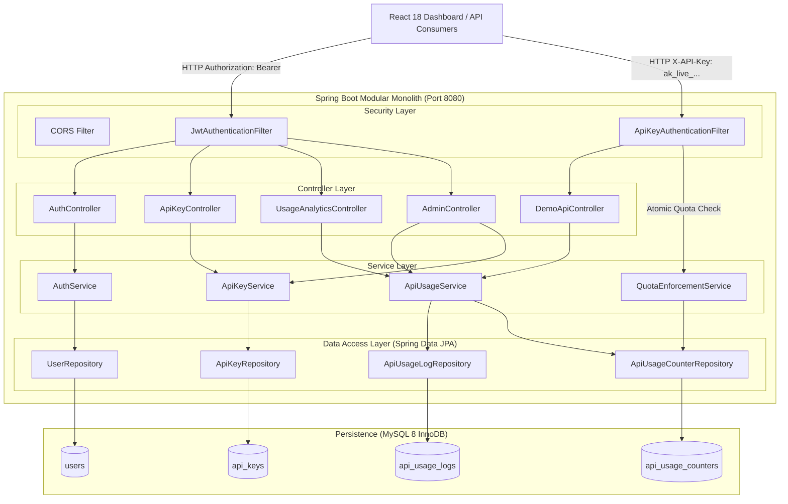
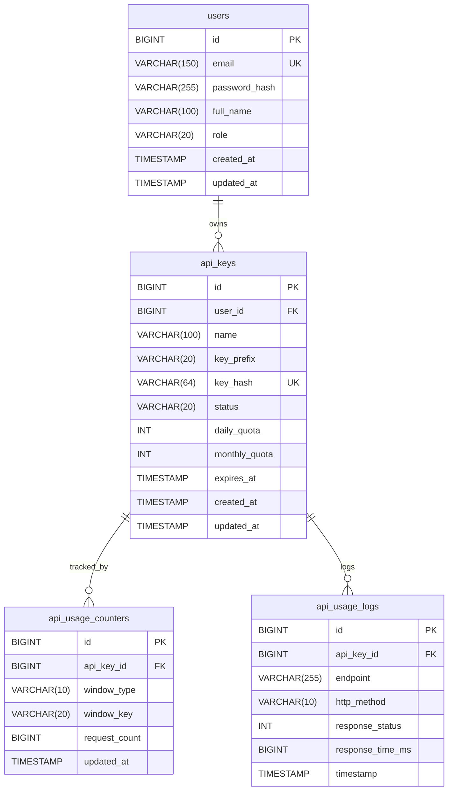

# Architecture & Technical Design Document

## 1. High-Level Architecture Diagram



---

## 2. Database Entity Relationship Diagram (ERD)



---

## 3. Concurrency-Safe Quota & Rate Limiting Design

### The Concurrency Problem
A naive rate limiting implementation performs:
1. `SELECT COUNT(*) FROM api_usage_logs WHERE ...`
2. If count < limit, process request and perform `INSERT INTO api_usage_logs ...`

Under high concurrency (e.g. 50 parallel requests when count is 99 and limit is 100), all 50 requests will read count = 99 and all 50 will proceed, resulting in 149 requests allowed.

### Our MySQL-Backed Atomic Solution
KeyShield solves this using **dedicated window counter rows** with **atomic SQL updates** and **InnoDB row-level locking**:

1. **Window Identification**:
   - Daily key: `YYYY-MM-DD` (UTC)
   - Monthly key: `YYYY-MM` (UTC)
2. **Atomic Row-Level Check & Increment**:
   ```sql
   UPDATE api_usage_counters
   SET request_count = request_count + 1, updated_at = :now
   WHERE api_key_id = :keyId
     AND window_type = :windowType
     AND window_key = :windowKey
     AND (:quota IS NULL OR request_count < :quota);
   ```
3. **Execution Semantics**:
   - InnoDB places an exclusive write lock on the target index row.
   - If `request_count < quota`, the counter increments and the query returns `updatedRows = 1`.
   - If `request_count >= quota`, the `WHERE` condition evaluates to false and the query returns `updatedRows = 0`.
   - If `updatedRows == 0`, a `QuotaExceededException` is thrown, returning **HTTP 429 Too Many Requests**.

### Scalability Considerations & Limitations
- **Strengths**: Zero external memory infrastructure (no Redis requirement), transactional durability, strict ACID consistency.
- **Trade-offs**: Under extremely high request volume (>10,000 req/sec per key), row lock contention on a single MySQL row can introduce database latency. In distributed hyperscale architectures, an in-memory token bucket or sliding log system (e.g., Redis Cluster + Lua scripts) is preferred to offload database transactions.

---

## 4. Security & Cryptographic Lifecycle

### API Key Secret Generation & Verification
1. **Secret Generation**:
   Keys are generated using `java.security.SecureRandom`, yielding 32 cryptographically random bytes (64 hex characters) prefixed by `ak_live_<prefix>_`.
2. **Storage**:
   The database never stores the raw secret. It stores a SHA-256 hash computed via `MessageDigest.getInstance("SHA-256")`.
3. **Lookup & Constant-Time Matching**:
   The unhashed prefix `ak_live_<8 hex>` identifies the database candidate, followed by `MessageDigest.isEqual(...)` for constant-time comparison against the incoming hash to eliminate timing attack vectors.
4. **One-Time Secret Revelation**:
   The full raw secret is returned exclusively in the `ApiKeyCreatedResponse` payload upon initial creation. Subsequent API endpoints return only the non-secret prefix and safe metadata.

### Stateless JWT vs Logout Limitations
- Authentication uses HMAC-SHA256 signed JWTs with 24-hour expiration.
- **Stateless Logout Limitation**: In a purely stateless JWT architecture, logging out on the client simply deletes the stored token from `localStorage`. The token remains mathematically valid until expiration on any machine that possesses it.
- **Production Trade-off**: Server-side invalidation would require maintaining a revocation denylist in a cache like Redis, transitioning the system to stateful session tracking. For this portfolio project, stateless expiration is adopted with an explicit architectural explanation.
